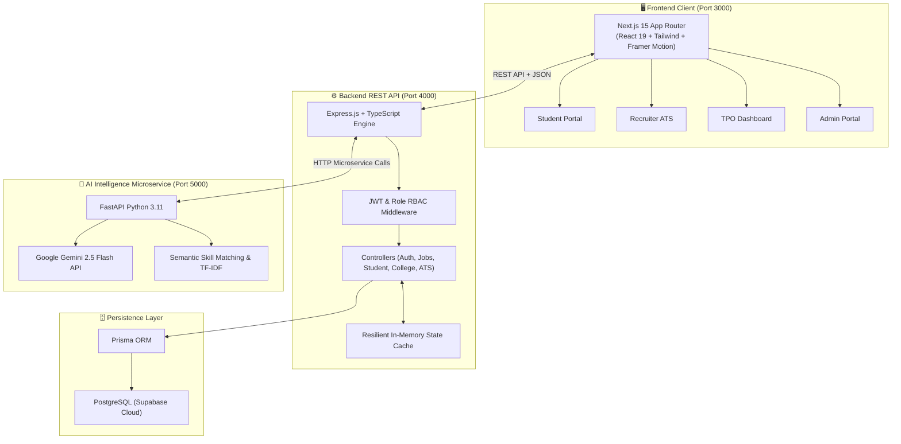

<div align="center">

# 🚀 TrueHire
### Next-Gen AI-Powered Hiring, Assessment & Placement Platform

[](https://nextjs.org/)
[](https://react.dev/)
[](https://www.typescriptlang.org/)
[](https://tailwindcss.com/)
[](https://nodejs.org/)
[](https://fastapi.tiangolo.com/)
[](https://python.org/)
[](https://ai.google.dev/)
[](https://prisma.io/)
[](https://postgresql.org/)
[](https://opensource.org/licenses/MIT)

<br/>

**Bridging the gap between ambitious students, top-tier recruiters, and university placement cells through intelligent automation and real-time AI evaluations.**

[Explore Features](#-key-features) • [Architecture](#-system-architecture) • [Quick Start](#-quick-start-guide) • [Demo Credentials](#-ready-to-use-demo-accounts) • [API Docs](#-api-endpoints-overview)

<br/>

</div>

---

## 📌 Executive Summary

**TrueHire** is an enterprise-ready, end-to-end recruitment and talent assessment ecosystem. Traditional hiring is broken: resumes are static, screening is manual and biased, and campus placement drives suffer from opaque communication.

TrueHire solves this through a unified **4-pillar architecture**:
1. **Students** get an AI coach with live video/speech mock interviews, continuous Hire-Ready scoring (0–100), and automated job-matching.
2. **Employers** get a verified hiring portal with drag-and-drop ATS Kanban pipelines, semantic candidate search, and automated screening.
3. **Colleges / Universities** get comprehensive placement intelligence dashboards tracking cohort readiness, placement ratios, and in-demand skills.
4. **Administrators** enjoy a centralized verification cockpit for employer GST/CIN authentication and platform oversight.

---

## 🌟 Key Features

### 🎓 1. For Students & Job Seekers
- 🎙️ **AI Mock Interview Simulator**: Interactive speech-to-text interview experience powered by **Google Gemini 2.5 Flash**. Generates instant scores, sentiment analysis, speech pace evaluation, and actionable feedback.
- 📈 **Dynamic Hire-Ready Score (0–100)**: Proprietary multi-factor readiness algorithm incorporating technical assessments, resume completeness, and soft-skill signals.
- 🎯 **Semantic 1-Click Job Matching**: Auto-ranks job vacancies based on semantic TF-IDF skill alignment against the candidate's verified profile.
- 📚 **Integrated Upskilling Courses**: Curated technical courses with live progress tracking and industry-recognized completion badges.
- 📂 **Digital Portfolio Builder**: Showcase GitHub repositories, live demo links, verified certifications, and assessment history.

### 🏢 2. For Employers & Recruiters
- 📋 **Visual ATS Kanban Board**: Full drag-and-drop candidate management across standard stages:
  $$\text{Applied} \longrightarrow \text{Reviewing} \longrightarrow \text{Shortlisted} \longrightarrow \text{Interview} \longrightarrow \text{Offered}$$
- 🛡️ **Verified Recruiter Badge**: Multi-point fraud protection with MCA / GST / CIN document verification before job postings go live.
- 🔍 **Talent Discovery Engine**: Filter applicants by exact Hire-Ready score brackets, specific tech stacks, and university cohorts.
- 📊 **Job Performance Analytics**: Track impressions, application conversion rates, and recruitment velocity in real time.

### 🏛️ 3. For Colleges & Placement Cells (TPO)
- 📊 **Placement Intelligence Dashboard**: Real-time KPI cards showcasing:
  - Overall Batch Placement Percentage
  - Average Package & Top Recruiter Distribution
  - Industry In-Demand Skills Radar
- 👥 **Cohort Monitoring**: Identify at-risk students who need upskilling before placement seasons begin.
- 🤝 **Recruiter Connect**: Facilitate on-campus and virtual hiring drives directly with verified corporate partners.

### 🛡️ 4. For Platform Administrators
- ⚖️ **Company Verification Gateway**: Inspect and approve/reject company GST certificates and business credentials.
- 📈 **Platform Health Monitor**: Monitor active users, server response metrics, database throughput, and error rates.

---

## 🏗️ System Architecture



---

## ⚡ Offline-First Dual-Engine Resilience

TrueHire is engineered with an **automatic high-availability failover engine**:
- **Primary Data Store**: Supabase PostgreSQL managed via Prisma ORM.
- **Failover State Engine**: If cloud database connectivity is throttled or sleeping, the backend instantly and seamlessly switches to an in-memory transactional cache.
- **Result**: Zero downtime during client demos, offline presentations, or cloud maintenance windows.

---

## 🛠️ Complete Tech Stack

| Domain | Technology | Description |
|---|---|---|
| **Frontend Framework** | `Next.js 15 (App Router)` | High-performance React framework with server-side rendering |
| **UI Library** | `React 19` | Modern declarative component architecture |
| **Styling** | `Tailwind CSS 3.4` + `@tailwindcss/postcss` | Utility-first styling with custom dark/light theme tokens |
| **Animations** | `Framer Motion` | Fluid micro-interactions and page transitions |
| **Icons & UI Primitives** | `Lucide React` + `Radix UI` | Accessible, production-ready interface primitives |
| **Backend Runtime** | `Node.js 20+` + `TypeScript` | Strongly-typed, scalable REST API service |
| **API Framework** | `Express.js` | Industry-standard HTTP request routing & middleware |
| **ORM & Database** | `Prisma ORM` + `PostgreSQL (Supabase)` | Type-safe database queries and automated schema migrations |
| **AI Microservice** | `FastAPI` (Python 3.11) | High-throughput asynchronous machine learning API |
| **AI LLM Engine** | `Google Gemini 2.5 Flash` | State-of-the-art multimodal reasoning and interview analysis |
| **Security & Auth** | `JWT` + `Bcrypt.js` + `Helmet` + `CORS` | Multi-tier security, password hashing, and rate limiting |

---

## 🚀 Quick Start Guide

### Prerequisites
- **Node.js**: `v18.0.0` or higher ([Download](https://nodejs.org/))
- **Python**: `v3.10` or higher ([Download](https://python.org/))
- **Git**: Installed and configured

---

### ⚡ Option 1: 1-Click Launch (Windows)

Just double-click the included batch launcher at the root of the project:
```cmd
START_ALL.bat
```
> **What this does:**
> - Spawns **AI Service** on `http://localhost:5000`
> - Spawns **Backend REST API** on `http://localhost:4000`
> - Spawns **Frontend Application** on `http://localhost:3000`
> - Each microservice runs in its own dedicated, live-reloading terminal window.

---

### 💻 Option 2: Manual Terminal Setup

#### 1️⃣ Clone the Repository
```bash
git clone https://github.com/shuyad02/TrueHire.git
cd TrueHire
```

#### 2️⃣ Start AI Microservice (Port 5000)
```bash
cd ai-service
python -m venv venv
# On Windows:
.\venv\Scripts\activate
# On Linux/macOS:
# source venv/bin/activate
pip install -r requirements.txt
python -m uvicorn main:app --host 0.0.0.0 --port 5000 --reload
```

#### 3️⃣ Start Backend API (Port 4000)
```bash
cd ../api
npm install
npm run dev
```

#### 4️⃣ Start Frontend Application (Port 3000)
```bash
cd ../web
npm install
npm run dev
```

Open your browser and navigate to **`http://localhost:3000`**.

---

## 🔑 Ready-to-Use Demo Accounts

The platform comes pre-seeded with instant-access test credentials for every user role:

| Role | Email Address | Password | Permissions & Dashboard |
|---|---|---|---|
| 🎓 **Student** | `student@truehire.in` | `Password123!` | Mock Interviews, Hire-Ready Score, Job Applications |
| 🏢 **Company / Recruiter** | `company@truehire.in` | `Password123!` | Job Posting, ATS Kanban Board, Applicant Review |
| 🏛️ **College / TPO** | `college@truehire.in` | `Password123!` | Placement Analytics, Student Cohort Tracking |
| 🛡️ **Super Admin** | `admin@truehire.in` | `Password123!` | Recruiter Verification, Platform Health Monitoring |

> 💡 *You can also create a brand-new account anytime using the **Register** button.*

---

## 🔌 API Endpoints Overview

### Authentication & Users (`/api/auth`)
| Method | Endpoint | Description | Access |
|---|---|---|---|
| `POST` | `/api/auth/register` | Register new user with role | Public |
| `POST` | `/api/auth/login` | Authenticate & issue JWT token | Public |
| `GET` | `/api/auth/me` | Fetch authenticated user profile | Private |

### Jobs & Applications (`/api/jobs`)
| Method | Endpoint | Description | Access |
|---|---|---|---|
| `GET` | `/api/jobs` | Search & filter active job openings | Public |
| `POST` | `/api/jobs` | Post new job opening | Recruiter |
| `GET` | `/api/jobs/:id` | Detailed job posting & matching info | Public |
| `POST` | `/api/jobs/:id/apply`| Submit 1-click job application | Student |

### AI Interview & Scoring (`/api/ai` & `/api/interview`)
| Method | Endpoint | Description | Access |
|---|---|---|---|
| `POST` | `/api/ai/analyze-interview` | Gemini AI interview speech evaluation | Student |
| `POST` | `/api/ai/match-resume` | Semantic candidate-job match calculation | Recruiter / Student |

---

## 📁 Repository Structure

```
TrueHire/
├── 📄 START_ALL.bat            # 1-Click launcher for all microservices
├── 📄 README.md                # Comprehensive project documentation
├── 📄 .gitignore               # Multi-stack git ignore rules
│
├── 🌐 web/                     # Frontend Next.js 15 Application
│   ├── src/
│   │   ├── app/                # App Router (Student, Company, College, Admin routes)
│   │   ├── components/         # Reusable UI components & navigation
│   │   ├── store/              # Zustand global client state management
│   │   └── middleware.ts       # Route guards & role authorization
│   ├── public/                 # Static assets & SVG icons
│   └── package.json
│
├── ⚙️ api/                     # Backend Express.js REST API
│   ├── src/
│   │   ├── controllers/        # Request handlers (auth, jobs, student, etc.)
│   │   ├── routes/             # Express API routing definitions
│   │   ├── middlewares/        # JWT auth & error handling middlewares
│   │   └── lib/                # Database clients & fallback engine
│   ├── prisma/                 # PostgreSQL schema definitions
│   └── package.json
│
└── 🧠 ai-service/              # Python FastAPI Machine Learning Service
    ├── main.py                 # FastAPI endpoints & Gemini AI integration
    ├── requirements.txt        # Python dependency manifest
    └── setup.ps1               # Automated Python environment setup script
```

---

## 🤝 Contributing

Contributions make the open-source community an incredible place to learn, inspire, and create! Any contributions you make are **greatly appreciated**.

1. Fork the Project
2. Create your Feature Branch (`git checkout -b feature/AmazingFeature`)
3. Commit your Changes (`git commit -m 'feat: Add some AmazingFeature'`)
4. Push to the Branch (`git push origin feature/AmazingFeature`)
5. Open a Pull Request

---

## 📄 License

Distributed under the **MIT License**. See `LICENSE` for more information.

---

<div align="center">

Made with ❤️ by [**Shubhash Yadav**](https://github.com/shuyad02)

⭐ If you find this project helpful or inspiring, please give it a **Star** on GitHub! ⭐

</div>
